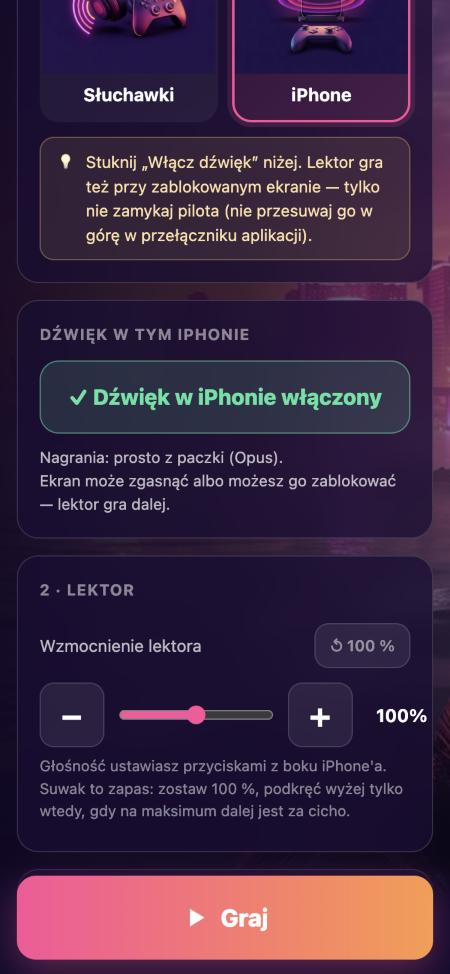

# GTA Lektor — polski lektor do GTA VI na Macu

Grasz w GTA VI na Xboxie, a obraz masz na telewizorze. Mac w tym czasie „patrzy” na napisy w grze i od razu
odtwarza je **polskim lektorem**: bohaterowie mówią po angielsku, a Ty słyszysz polskiego lektora jak w filmie.

Lektor gra z głośników Maca, z głośnika Bluetooth, ze słuchawek albo z **iPhone'a**. Telefon może też być
**pilotem**: włączasz i wyłączasz lektora oraz zmieniasz głośność z kanapy.

| Panel na Macu | Pilot w iPhonie | iPhone jako głośnik lektora |
|---|---|---|
|  |  |  |

## Jak to działa (po ludzku)

1. Na Macu w przeglądarce Chrome działa **gra zdalna Xboxa** (xbox.com) — tylko po to, żeby Mac widział obraz gry.
   Grasz normalnie na telewizorze, bez opóźnień.
2. Kilka razy na sekundę program odczytuje napis z ekranu (wbudowane w macOS rozpoznawanie tekstu).
3. Szuka tego zdania w **paczce lektora** — gotowych polskich nagrań przygotowanych przez społeczność
   [GameReader](https://gamereader.pl) — i odtwarza właściwe nagranie.

Nic nie jest wysyłane do internetu: wszystko dzieje się na Twoim Macu.

## Czego potrzebujesz

- Maca (testowane na MacBooku Air M4 z nowym macOS) i przeglądarki **Google Chrome**,
- Xboxa z GTA VI i grą zdalną (albo kartę przechwytującą obraz z przelotem na telewizor),
- **paczki lektora GTA VI** dla GameReadera 2.0 — pobierasz ją sam ze strony [gamereader.pl](https://gamereader.pl)
  (ok. 2,9 GB; nie ma jej w tym repo, bo należy do jej autorów),
- opcjonalnie iPhone'a w tym samym Wi-Fi.

## Instalacja — zrobi to za Ciebie AI

Nie musisz znać się na programowaniu. Otwórz **Claude Code** (w aplikacji Claude: zakładka „Code”) albo **Codex**
i wklej:

> Zainstaluj mi GTA Lektor z https://github.com/maciek1027/gta-lektor-mac — postępuj według pliku AGENTS.md z tego repo.

AI pobierze program, przygotuje go i zbuduje aplikację „GTA Lektor” z ikonką. Ty zrobisz tylko trzy rzeczy:

1. **Pobierzesz paczkę lektora** z [gamereader.pl](https://gamereader.pl) i wrzucisz plik `.zip` do folderu
   `paczki` (AI pokaże Ci gdzie).
2. **Klikniesz zgody macOS**, gdy system zapyta (lista niżej).
3. **Ustawisz napisy w grze** (niżej).

<details>
<summary>Wolisz sam, w Terminalu?</summary>

```bash
git clone https://github.com/maciek1027/gta-lektor-mac.git
cd gta-lektor-mac
./instaluj.sh
```
Potrzebny Python 3.10+ (np. `brew install python`). Paczkę `.zip` wrzuć do folderu `paczki/`.
</details>

## Pierwsze uruchomienie — zgody macOS

Uruchom **GTA Lektor** z Aplikacji. Otworzy się małe okno Terminala (serwer lektora — nie zamykaj go, możesz
zminimalizować) i panel w oknie Chrome. macOS zapyta o kilka rzeczy — na wszystko odpowiedz **Zezwól / OK**:

- **Nagrywanie ekranu dla „Terminal”** — bez tego lektor nie widzi napisów. Ustawienia systemowe → Prywatność
  i ochrona → Nagrywanie ekranu i dźwięku z systemu → włącz Terminal. Potem zamknij panel i otwórz GTA Lektor jeszcze raz.
- **Dostęp do folderu** (np. Dokumenty albo Pobrane) dla „GTA Lektor”.
- **„GTA Lektor” chce sterować Terminalem** — OK.
- Przy karcie przechwytującej: **kamera** dla Terminala. Przy pilocie z włączoną zaporą: **połączenia przychodzące** dla Pythona.

## Ustawienia w grze

- GTA VI: napisy **włączone**, rozmiar napisów **mały**. Jeśli lektor gubi kwestie (napis na jasnym tle, np. niebo,
  woda, neony), włącz też **tło napisów na 100 %** — ciemny pasek pod tekstem; tak zalecają autorzy paczki. U autora
  tego programu działało też bez tła.
- Gra zdalna w Chrome (`xbox.com/play`) na **pełnym ekranie** Maca.
- **Dźwięk gry na telewizorze:** gdy włączasz grę zdalną, Xbox przerzuca dźwięk na Maca. Na Xboxie wejdź w
  Ustawienia → Ogólne → Głośność i wyjście audio → Dodatkowe opcje i **odznacz** „Wycisz dźwięk głośnika, gdy
  podłączony jest zestaw słuchawkowy”. W Chrome wycisz kartę Xbox (prawy klik → „Wycisz witrynę”).

## Jak słuchać

| Profil | Gra | Lektor |
|---|---|---|
| TV + Mac | telewizor | głośniki Maca |
| TV + głośnik | telewizor | głośnik Bluetooth połączony z Makiem |
| Słuchawki | słuchawki przy Macu | słuchawki przy Macu |
| iPhone | telewizor | iPhone (głośnik albo jego słuchawki) — działa też przy zablokowanym ekranie |

**Pilot w iPhonie:** w panelu na Macu jest kod QR. Zeskanuj go aparatem, a w Safari wybierz Udostępnij → „Do ekranu
początkowego”. Pilot wpuszcza tylko telefony z tajnym kodem z QR. „Nowy kod” w panelu unieważnia stare ikonki.

**Głośność:** w profilu „iPhone” ustawiasz ją przyciskami z boku telefonu, a suwak, „−”, „+” i „↺ 100 %” służą do
dodatkowego wzmocnienia lektora. W pozostałych profilach suwak zmienia głośność lektora na Macu.

## Coś nie działa?

Najprościej: otwórz Claude Code albo Codex w folderze programu i napisz, co się dzieje — AI ma instrukcję
(`AGENTS.md`) i sprawdzi dziennik `~/Library/Logs/gta-lektor.log`. Najczęstsze przyczyny: brak zgody na nagrywanie
ekranu, gra nie na pełnym ekranie, napisy w grze wyłączone (albo bez tła na jasnej scenie), brak paczki w folderze `paczki`.

## Ważne

- To niezależny projekt hobbystyczny. Nie jest powiązany z Rockstar Games, Take-Two, Microsoftem (Xbox) ani
  z twórcami GameReadera.
- Paczki lektora tworzy społeczność GameReadera — pobieraj je z ich strony i korzystaj zgodnie z ich zasadami.
  To repo zawiera tylko program, który odtwarza paczkę w formacie GameReader 2.0 na Macu.
- Licencja kodu: [MIT](LICENSE).
