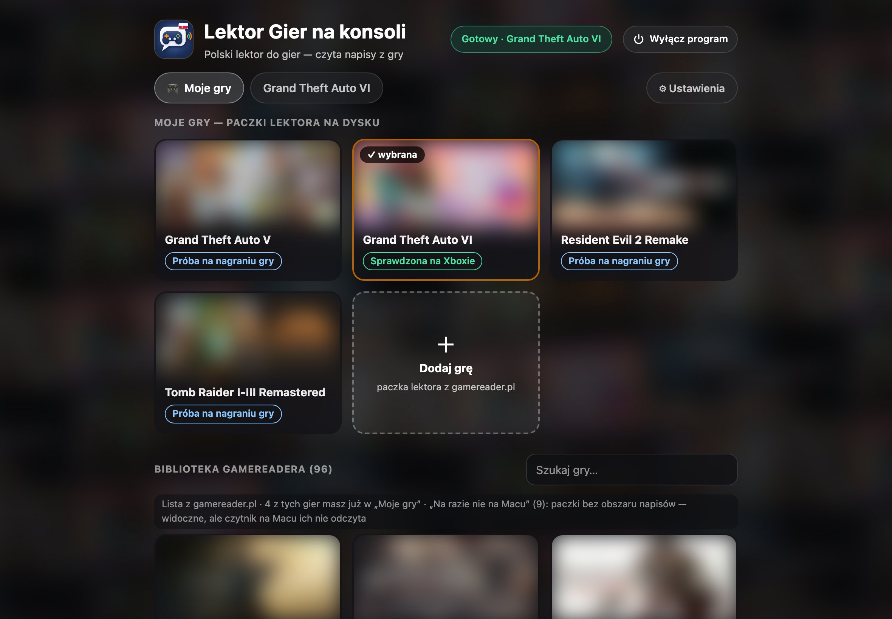
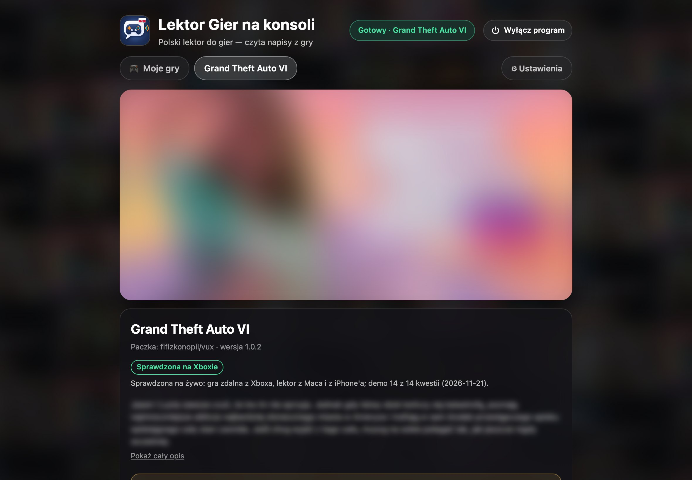
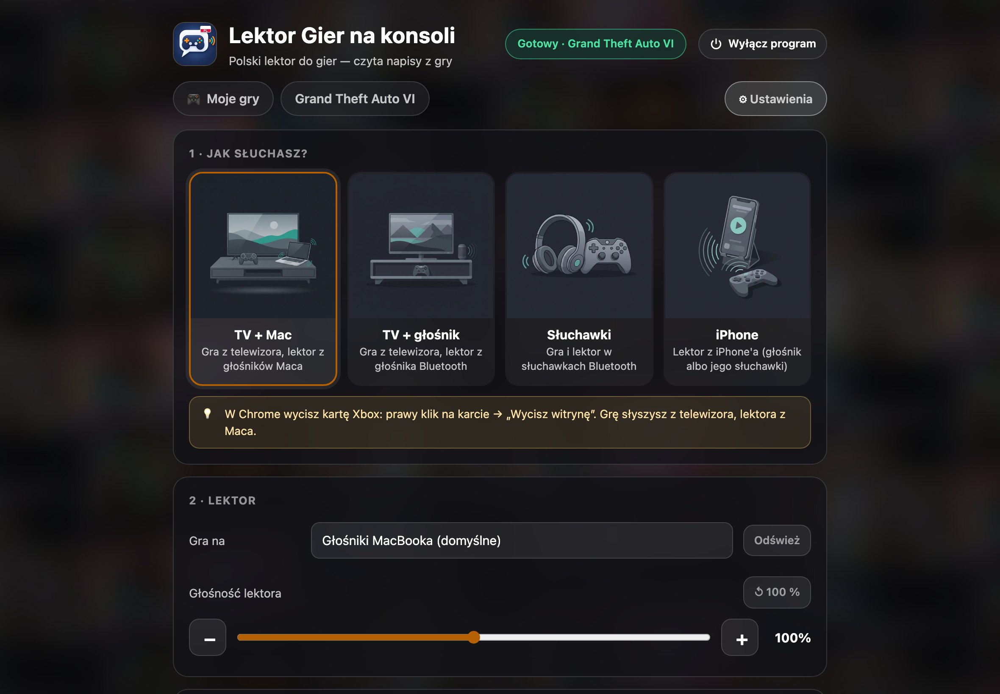
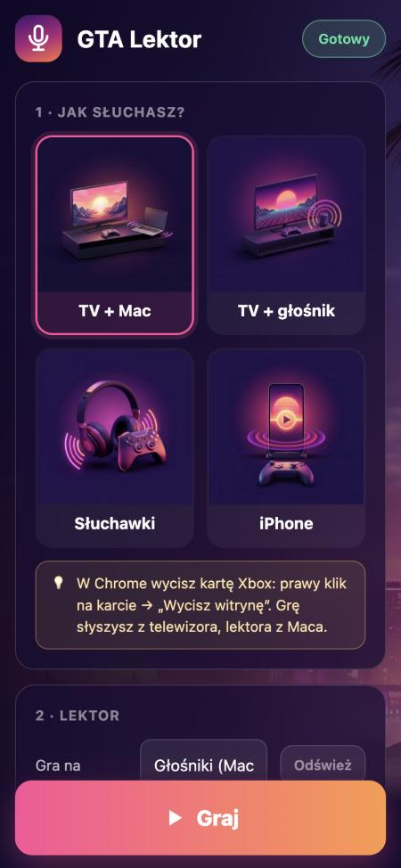
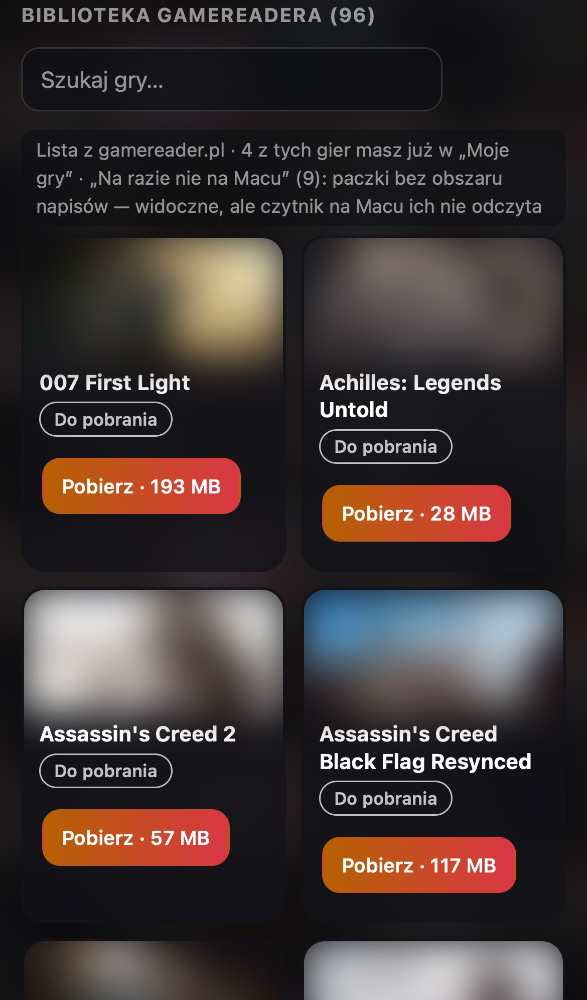
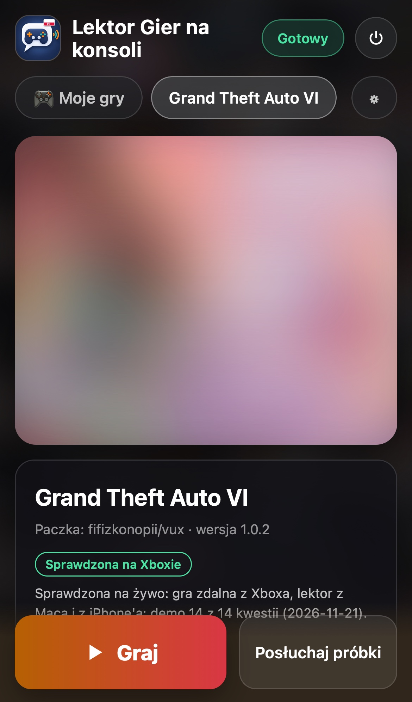

# Lektor Gier na konsoli — polski lektor do gier na Macu

Grasz na konsoli (Xbox albo PlayStation 5), a obraz masz na telewizorze. Mac w tym czasie „patrzy” na napisy w grze i od razu odtwarza je
**polskim lektorem**: bohaterowie mówią po angielsku, a Ty słyszysz polskiego lektora jak w filmie.

Program działa jak **katalog gier**: każda gra, do której masz paczkę lektora społeczności
[GameReader](https://gamereader.pl), ma w nim swój kafelek z okładką. Wybierasz grę, klikasz „Graj” — i tyle.
Na żywo na Xboxie sprawdzona jest na razie jedna gra (GTA VI); kilka innych przeszło próbę na nagraniu gry.
**Na PlayStation 5 program nie był jeszcze sprawdzony** — działa tą samą drogą, ale nikt go tam jeszcze nie próbował
(szczegóły w „Ustawieniach w grze i na konsoli”).
Paczki mają wspólny format, ale nie każda zadziała tak samo — część używa ustawień, których ten program jeszcze
nie stosuje, a niektóre nie mają obszaru napisów. Przy każdej grze panel mówi wprost, jak bardzo jest sprawdzona.

Lektor gra z głośników Maca, z głośnika Bluetooth, ze słuchawek albo z **iPhone'a**. Telefon może też być
**pilotem**: włączasz i wyłączasz lektora oraz zmieniasz głośność z kanapy.

| Moje gry — katalog na Macu | Ekran gry | Ustawienia |
|---|---|---|
|  |  |  |

| Biblioteka GameReadera — „Pobierz” na Macu |
|---|
|  |

| Pilot w iPhonie | Biblioteka w iPhonie | Ekran gry w iPhonie |
|---|---|---|
|  |  |  |

<sub>Okładki gier na zrzutach są celowo rozmyte — należą do wydawców i autorów paczek, w programie widzisz je normalnie.</sub>

## Jak to działa (po ludzku)

1. Na Macu działa **gra zdalna** Twojej konsoli — Xbox w przeglądarce Chrome (xbox.com), PlayStation 5 w aplikacji
   Sony **PS Remote Play** — tylko po to, żeby Mac widział obraz gry.
   Grasz normalnie na telewizorze, bez opóźnień.
2. Kilka razy na sekundę program odczytuje napis z ekranu (wbudowane w macOS rozpoznawanie tekstu).
3. Szuka tego zdania w **paczce lektora** wybranej gry — gotowych polskich nagrań przygotowanych przez społeczność
   GameReadera — i odtwarza właściwe nagranie.

Nic nie jest wysyłane do internetu: wszystko dzieje się na Twoim Macu.

## Czego potrzebujesz

- Maca (testowane na MacBooku Air M4 z nowym macOS) i przeglądarki **Google Chrome**,
- Xboxa z grą zdalną albo PlayStation 5 z aplikacją **PS Remote Play** na Macu (albo kartę przechwytującą obraz
  z przelotem na telewizor — przy PS5 trzeba na konsoli wyłączyć HDCP, patrz niżej),
- **paczek lektora** do Twoich gier w formacie GameReader 2.0 — pobierasz je przyciskiem „Pobierz” w sekcji
  „Biblioteka GameReadera” programu (lista i pliki prosto z serwera [gamereader.pl](https://gamereader.pl)) albo sam
  z ich strony (nie ma ich w tym repo, bo należą do ich autorów),
- opcjonalnie iPhone'a w tym samym Wi-Fi.

## Instalacja — zrobi to za Ciebie AI

Nie musisz znać się na programowaniu. Otwórz **Claude Code** (w aplikacji Claude: zakładka „Code”) albo **Codex**
i wklej:

> Zainstaluj mi lektora gier z https://github.com/maciek1027/lektor-gier-mac — postępuj według pliku AGENTS.md z tego repo.

AI pobierze program, przygotuje go i zbuduje aplikację z ikonką **„Lektor Gier na konsoli”** w Aplikacjach. Ty zrobisz
tylko trzy rzeczy:

1. **Dodasz grę:** w panelu pod „Moje gry” jest **Biblioteka GameReadera** — znajdź grę (szukajka) i kliknij
   „Pobierz”; po pobraniu i sprawdzeniu paczki gra sama przejdzie do „Moje gry”. Paczkę spoza biblioteki pobierzesz
   z [gamereader.pl](https://gamereader.pl) i wrzucisz plik `.zip` do folderu gier (`paczki`; kafelek „＋ Dodaj grę”
   ma przycisk „Otwórz folder gier”) — pojawi się sama po ok. 5 sekundach.
2. **Klikniesz zgody macOS**, gdy system zapyta (lista niżej).
3. **Ustawisz napisy w grze** (niżej i na ekranie gry w panelu).

<details>
<summary>Wolisz sam, w Terminalu?</summary>

```bash
git clone https://github.com/maciek1027/lektor-gier-mac.git
cd lektor-gier-mac
./instaluj.sh
```
Potrzebny Python 3.10+ (np. `brew install python`). Paczki `.zip` wrzuć do folderu `paczki/`.
Paczki na innym dysku? Utwórz w folderze programu plik `lokalne.env` (poza gitem), np.
`LEKTOR_PACZKI=/Volumes/Dysk/paczki` (folder gier), `LEKTOR_PACZKA=…/gra.zip` (gra wybierana na start, gdy panel
nie ma jeszcze zapisanego wyboru), `LEKTOR_DEMO=…/film.mp4`. Te same nazwy działają jako zmienne środowiska.
Testy: `.venv/bin/python -m unittest discover -s testy`.
</details>

## Pierwsze uruchomienie — zgody macOS

Uruchom **Lektor Gier na konsoli** z Aplikacji. Otworzy się małe okno Terminala (serwer lektora — nie zamykaj go, możesz
zminimalizować) i panel w oknie Chrome. macOS zapyta o kilka rzeczy — na wszystko odpowiedz **Zezwól / OK**:

- **Nagrywanie ekranu dla „Terminal”** — bez tego lektor nie widzi napisów. Ustawienia systemowe → Prywatność
  i ochrona → Nagrywanie ekranu i dźwięku z systemu → włącz Terminal. Potem wyłącz program i otwórz go jeszcze raz.
- **Dostęp do folderu** (np. Dokumenty albo Pobrane) dla „Lektor Gier na konsoli”.
- **„Lektor Gier na konsoli” chce sterować Terminalem** — OK.
- Przy karcie przechwytującej: **kamera** dla Terminala. Przy pilocie z włączoną zaporą: **połączenia przychodzące** dla Pythona.

**Wyłączanie:** przycisk „Wyłącz program” w prawym górnym rogu panelu zatrzymuje lektora i serwer. Włączasz go znów
ikonką „Lektor Gier na konsoli”. Masz jeszcze starą aplikację **„GTA Lektor”** (dawna nazwa)? Po pierwszym
uruchomieniu nowej możesz ją usunąć z Aplikacji i wyciągnąć jej ikonkę z Docka.

## Jak używać

1. **Kliknij ikonkę „Lektor Gier na konsoli”** w Docku. Program zawsze otwiera się na **Moje gry** — katalogu
   wszystkich gier, do których masz paczkę lektora.
2. **Wybierz grę** (kafelek z okładką). Na ekranie gry zobaczysz, jak bardzo jest sprawdzona, ramkę „Ustaw w grze”
   ze słowami autora paczki i przycisk **Graj**.
3. **Kliknij Graj.** Program otworzy grę zdalną Twojej konsoli (Xbox w Chrome albo aplikację PS Remote Play)
   i zacznie czytać napisy. Kafelek gry dostaje znak
   „▶ czyta”, a z każdego ekranu możesz lektora zatrzymać paskiem „Zatrzymaj lektora”.
4. **Nowa gra:** sekcja **Biblioteka GameReadera** pod „Moje gry” (wszystkie paczki z gamereader.pl, z okładkami
   i szukajką) → „Pobierz · rozmiar” → pasek postępu (obok otwiera się biblioteka na stronie GameReadera — twórcy paczek
   zostają w zasięgu wzroku) → sprawdzenie paczki → gra w „Moje gry”. Gdy biblioteka w programie nie działa, panel
   pokazuje instrukcję pobrania ręcznego z przyciskiem strony GameReadera. Jedno pobieranie
   naraz; brak internetu, odłączony dysk z grami albo mało miejsca program mówi wprost na kafelku. Gry bez obszaru
   napisów są oznaczone „Na razie nie na Macu” (widać je, ale czytnik ich nie odczyta). Działa też z pilota w iPhonie
   (paczka trafia na Maca). Paczka spoza biblioteki: kafelek „＋ Dodaj grę” → wrzuć `.zip` do folderu gier.
5. **Ustawienia** (przycisk z zębatką): jak słuchasz (TV + Mac, głośnik, słuchawki, iPhone), wzmocnienie lektora,
   wygląd (Motyw gry, Okładki, Grafit, Granat) i kod QR pilota dla iPhone'a. W „Więcej opcji” wybierasz, skąd
   program bierze obraz gry: gra zdalna (konsola **Xbox** albo **PlayStation 5**) albo karta przechwytująca.
6. **Koniec grania:** „Wyłącz program” w prawym górnym rogu.

## Ustawienia w grze i na konsoli

- Napisy w grze **włączone**. Rozmiar i tło napisów zależą od paczki — ekran gry w panelu pokazuje słowa autora
  paczki („Ustaw w grze”). Przykład GTA VI: napisy **małe**, a gdy lektor gubi kwestie na jasnych scenach, włącz
  **tło napisów na 100 %**.
- **Xbox:** gra zdalna w Chrome (`xbox.com/play`) na **pełnym ekranie** Maca.
- **Dźwięk gry na telewizorze (Xbox):** gdy włączasz grę zdalną, Xbox przerzuca dźwięk na Maca. Na Xboxie wejdź w
  Ustawienia → Ogólne → Głośność i wyjście audio → Dodatkowe opcje i **odznacz** „Wycisz dźwięk głośnika, gdy
  podłączony jest zestaw słuchawkowy”. W Chrome wycisz kartę Xbox (prawy klik → „Wycisz witrynę”).
- **PlayStation 5 — gra zdalna:** PS5 nie ma gry zdalnej w przeglądarce. Zainstaluj na Macu aplikację Sony
  **PS Remote Play** (strona Sony, „PS Remote Play Mac”), połącz ją z konsolą i ustaw jej okno na **pełny ekran**.
  W programie: Ustawienia → Więcej opcji → Konsola: **PlayStation 5**. „Graj” otworzy wtedy tę aplikację zamiast
  Chrome; gdy jej nie ma, program powie, co zrobić.
- **PlayStation 5 przez kartę przechwytującą:** PS5 szyfruje obraz na HDMI (HDCP) i karta widzi czarny ekran.
  Na konsoli: Ustawienia → System → HDMI → **Włącz HDCP** — wyłącz. Treści, które wymagają HDCP, nie zadziałają
  wtedy na konsoli — po graniu włącz HDCP z powrotem.
- ⚠️ **Na PS5 nikt jeszcze tego nie sprawdził.** Obszar napisów w paczkach GameReadera przygotowano pod grę na
  komputerze; obraz z PS Remote Play może mieć inne ramki albo inny rozmiar napisów. Gdy lektor gubi kwestie albo
  milczy — daj znać (sekcja „Grasz w grę, której nie ma na liście sprawdzonych?”).

## Jak słuchać

| Profil | Gra | Lektor |
|---|---|---|
| TV + Mac | telewizor | głośniki Maca |
| TV + głośnik | telewizor | głośnik Bluetooth połączony z Makiem |
| Słuchawki | słuchawki przy Macu | słuchawki przy Macu |
| iPhone | telewizor | iPhone (głośnik albo jego słuchawki) — działa też przy zablokowanym ekranie |

**Pilot w iPhonie:** w panelu na Macu (Ustawienia) jest kod QR. Zeskanuj go aparatem, a w Safari wybierz
Udostępnij → „Do ekranu początkowego”. Pilot wpuszcza tylko telefony z tajnym kodem z QR. „Nowy kod” w panelu
unieważnia stare ikonki.

**Głośność:** w profilu „iPhone” ustawiasz ją przyciskami z boku telefonu, a suwak, „−”, „+” i „↺ 100 %” służą do
dodatkowego wzmocnienia lektora. W pozostałych profilach suwak zmienia głośność lektora na Macu.

## Coś nie działa?

Najprościej: otwórz Claude Code albo Codex w folderze programu i napisz, co się dzieje — AI ma instrukcję
(`AGENTS.md`) i sprawdzi dziennik `~/Library/Logs/gta-lektor.log`. Najczęstsze przyczyny: brak zgody na nagrywanie
ekranu, gra nie na pełnym ekranie, napisy w grze wyłączone (albo bez tła na jasnej scenie), brak paczki w folderze gier.

## Grasz w grę, której nie ma na liście sprawdzonych?

Podziel się wynikiem — działa czy nie, z jakimi ustawieniami napisów. Twoje AI zapyta o to samo po pierwszej próbie
i przygotuje zgłoszenie, a Ty decydujesz, czy je wysłać. Jak to zrobić samodzielnie: [CONTRIBUTING.md](CONTRIBUTING.md).

## Ważne

- To niezależny projekt hobbystyczny. Nie jest powiązany z twórcami gier ani wydawcami, z Microsoftem (Xbox), z Sony
  (PlayStation) ani z twórcami GameReadera.
- Paczki lektora tworzy społeczność GameReadera — korzystaj z nich zgodnie z ich zasadami. Biblioteka w programie
  czyta publiczną listę paczek i pobiera paczki z serwera GameReadera (tego samego, z którego korzysta ich program);
  nie wysyła tam nic o Tobie poza ogólną nazwą programu. Paczki zapisuje bez zmian w Twoim folderze gier. Pobieranie
  z programu wyłączysz linią `LEKTOR_POBIERANIE=0` w `lokalne.env` (biblioteka pokaże wtedy link do strony gry).
  To repo zawiera tylko program, który odtwarza paczki w formacie GameReader 2.0 na Macu.
- Licencja kodu: [MIT](LICENSE).
